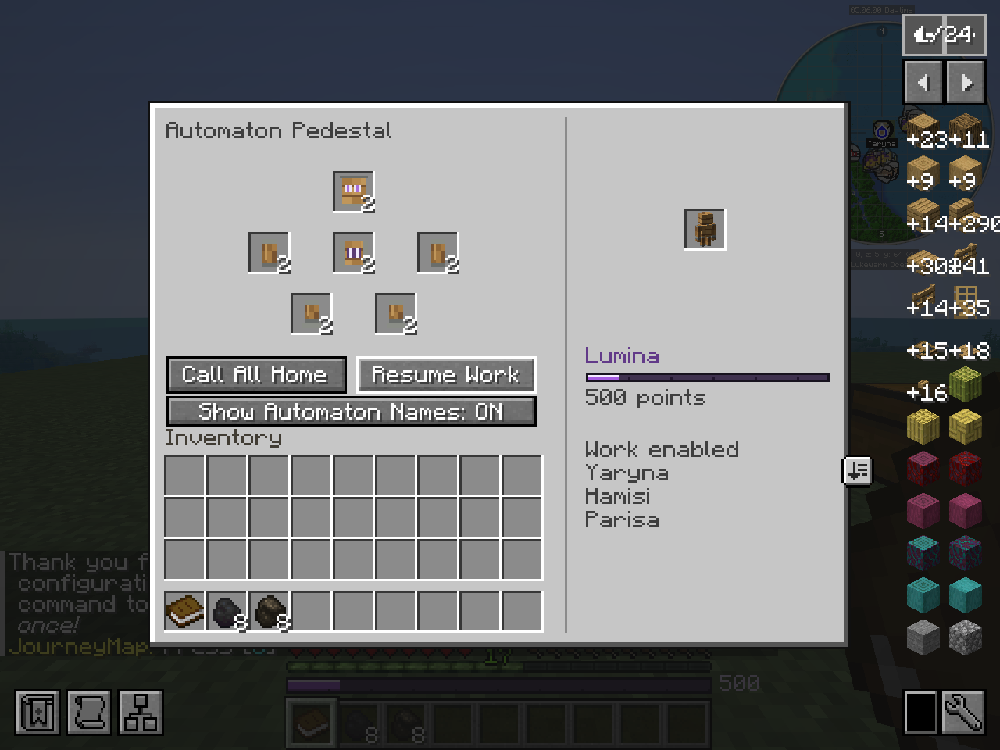

---
navigation:
  title: "Automaton Pedestal"
  parent: "network/index.md"
  position: 1
  icon: "automatons:pedestal"
item_ids:
  - "automatons:pedestal"
---

# Automaton Pedestal

Place your home Pedestal before assembling workers. It owns the Network's worker identities, names, overview and recall controls.

<Recipe id="automatons:pedestal" />

Put the six [body parts](../items/components.md) into their matching positions: head at the top, torso between two arms, and two legs below. Take the assembled Automaton and place it near its home.

<Recipe id="automatons:automaton" />

For a Guardington, use a complete armored set in the same six positions. Mixed ordinary and armored sets are rejected.

<Recipe id="automatons:guardington" />

The assembly shown here is a live Creation Pedestal recipe. It is not a crafting-table recipe and the display itself creates no worker identity.
The floating figure above the Pedestal is a display; it is not an extra worker.

**Call All Home** takes priority over assigned jobs; **Resume Work** allows workers to resume. The **Work enabled/disabled** summary shows the current state.
Recalling a courier preserves its real parcel. Keep paths and storage usable so workers can return and unload.

**Build Lists** shows unfinished buildings and active mine infrastructure in this Pedestal's Network. Choose a project to view its scrollable **Total / Left / Have / Need** material counts. Available supplies include the assigned worker's cargo and valid supply chests. Paused projects remain listed; completed builds disappear. Unloaded worksites stay listed without guessing their inventory counts.

The home interface shows assembly slots, recall/resume controls, Lumina and the worker roster.
