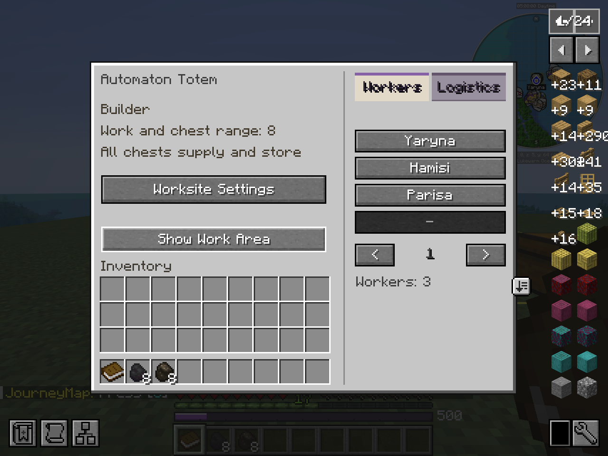
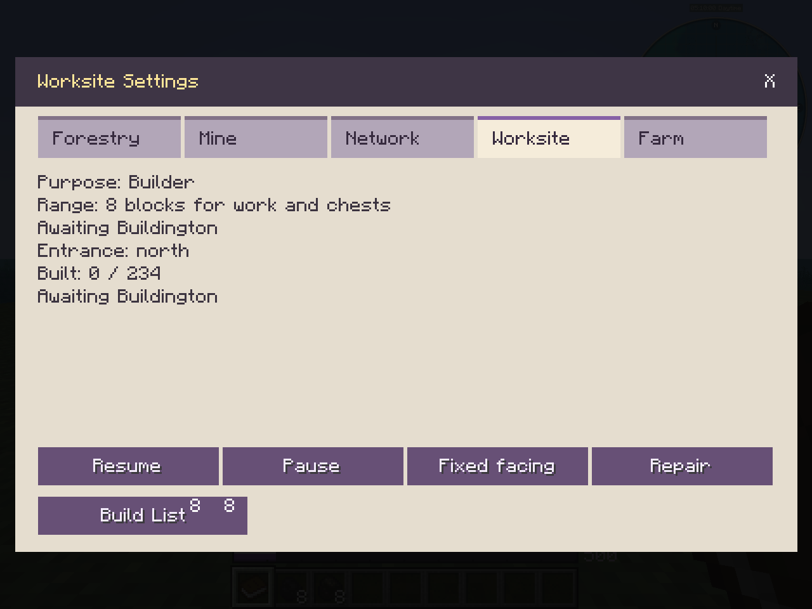

---
navigation:
  title: "Totems and one shared range"
  parent: "network/index.md"
  position: 2
  icon: "automatons:totem"
item_ids:
  - "automatons:totem"
---

# Totems and one shared range

Place a Totem where the building's rear-wall anchor should remain. Open **Worksite Settings**, choose its purpose and facing, then **Create Worksite**.
The yellow glowing perimeter marks the planned building. The Totem stays in place.

<Recipe id="automatons:totem" />

Each Totem has **one horizontal range** for work and nearby chests. There is no inner exclusion and no separate storage radius.

| Purpose | Default radius |
| --- | ---: |
| Lumber Yard | 32 blocks |
| Farm | 32 blocks |
| Mine entrance | 6 blocks |
| Builder | 8 blocks |
| Warehouse | 8 blocks |

These are horizontal square areas. The mine's underground workings and registered depot extend beyond its small surface range.
**Show Work Area** displays coverage. Chests are input and output by default; both halves of a double chest need valid access and open lids.

**Workers** shows assignments and individual pages. **Find** outlines an owned loaded worker for 30 seconds.
**Logistics** lists current activities, requests and deliveries. An amber beacon means this site has workers needing attention; open their status to see why.
The Worksite Settings popup groups profession controls in tabs.

The Workers and Logistics tabs share one worksite range.

Choose the purpose and orientation in the Worksite tab before approving construction.

An assigned worker joins a site to its home Network. A site cannot be shared by unrelated home Networks.
