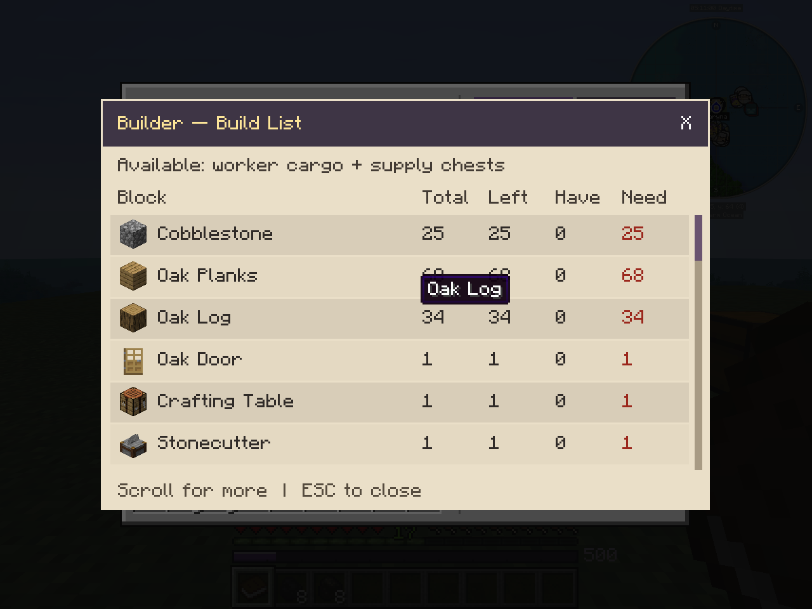

---
navigation:
  title: "Worksites and buildings"
  parent: "index.md"
  position: 5
  icon: "automatons:totem"
---

# Worksites and buildings

Configure a Totem, review its footprint, supply the Build List and let a Buildington construct the site.

Build List shows **Total**, **Left**, **Have** and **Need**. Scroll for the remaining materials. The example is a Builder site; your live list follows your blueprint and available supplies.

<SubPages icons={true} />
